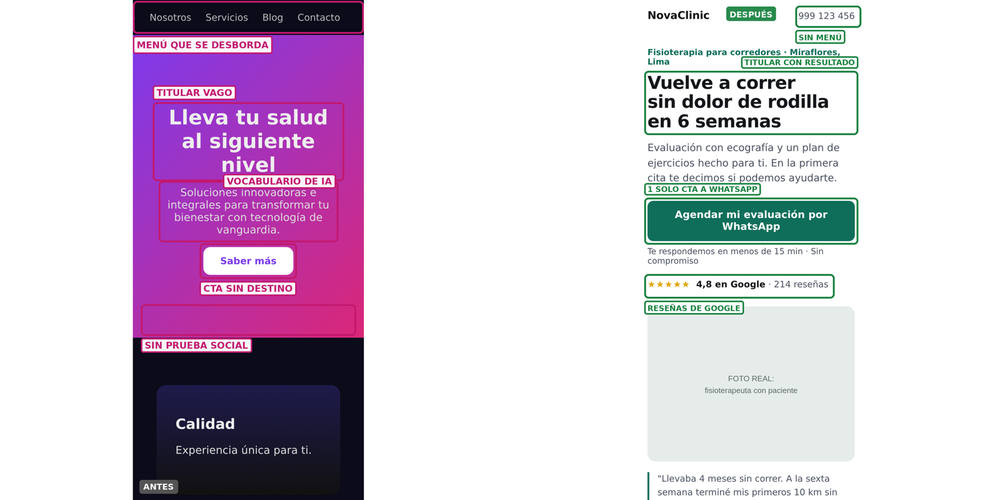

# Landing que vende

Dos skills para Claude Code (y cualquier agente que lea `SKILL.md`) que responden la pregunta que importa: **¿esta landing vende?**

| Skill | Qué hace | Pídele |
|---|---|---|
| **`auditor-landing`** | Captura tu landing en escritorio y celular, la puntúa sobre 100 con una rúbrica de conversión, **etiqueta cada defecto sobre la captura** ("TITULAR VAGO", "CTA SIN DESTINO", "SIN PRUEBA SOCIAL") y te da el arreglo escrito. Si lo pides, arma el "después" y la comparación antes/después lista para reel o carrusel. | *"Audita https://miweb.com"* · *"¿Por qué mi landing no vende?"* · *"Hazme el antes y después de esta landing para un reel"* |
| **`landing-pyme`** | Escribe la estructura y el copy completo de una landing para negocios de servicios (consultorio, clínica, agencia, despacho, taller…) cuyo objetivo es que te escriban por **WhatsApp** o agenden. Entrega el copy, el enlace de WhatsApp con mensaje prellenado y un prompt para construirla en Lovable, v0, Framer o Claude — o el HTML listo. | *"Hazme la landing de mi consultorio dental en Lima"* · *"Reescribe mi landing para que lleve a WhatsApp"* |



*Ejemplo con una clínica ficticia: a la izquierda, la landing genérica que entrega una IA sin indicaciones; a la derecha, el primer pantallazo reescrito con los arreglos.*

## Instalar

**Claude Code (como plugin):**
```
/plugin marketplace add webtaken/landing-que-vende
/plugin install landing-que-vende@landing-que-vende
```

**Solo copiar las skills** (Claude Code, Codex, Cursor, Gemini CLI…):
```bash
git clone https://github.com/webtaken/landing-que-vende
cp -r landing-que-vende/skills/* ~/.claude/skills/
```

**Requisitos para capturar y anotar** (solo `auditor-landing`):
```bash
pip install playwright pillow
python -m playwright install chromium
```

## Cómo se usan juntas

1. `auditor-landing` sobre tu landing actual → puntaje, defectos etiquetados, arreglos.
2. `landing-pyme` para reescribirla con la estructura que vende.
3. `auditor-landing` otra vez sobre la nueva → comparar puntajes y sacar el antes/después.

## Complemento recomendado: skills de diseño de Landingfolio

Estas skills miran **conversión y copy**. Para el **diseño visual** (jerarquía, tipografía, color, espaciado, móvil) usa las 7 skills gratuitas (MIT) de [Landingfolio](https://landingfolio.com/skills) de [Danny Postma](https://x.com/dannypostma): `landing-page-audit`, `humanize-copy-pass`, `explore-landing-sections`, `extract-design-system`, `mobile-responsive-pass`, `screenshot-capture` y `share-image-generator`. `auditor-landing` le pasa los defectos de diseño puro a `landing-page-audit` cuando está instalada.

```bash
for s in landing-page-audit humanize-copy-pass explore-landing-sections extract-design-system mobile-responsive-pass screenshot-capture share-image-generator; do
  mkdir -p ~/.claude/skills && curl -fsSL "https://landingfolio.com/skills/$s.tar" | tar -x -C ~/.claude/skills
done
```

## De dónde sale la rúbrica

Cada criterio y cada dato tiene su fuente en [`skills/auditor-landing/references/fuentes.md`](skills/auditor-landing/references/fuentes.md). Las skills tienen prohibido usar cifras que no estén ahí.

## Licencia

MIT — úsalas, modifícalas y compártelas. Hecho por [Saul Rojas (@saulautomatiza)](https://www.instagram.com/saulautomatiza/).
